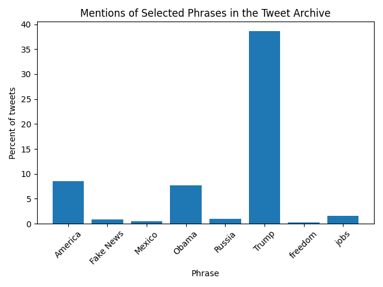

# [lab-web-data](https://csci40.rtealwitter.com/topics/05_web_scraping/lab.html)

| phrase            | percent of tweets |
| ----------------- | ----------------- |
|           America | 08.58             |
|         Fake News | 00.88             |
|            Mexico | 00.45             |
|             Obama | 07.73             |
|            Russia | 00.91             |
|             Trump | 38.58             |
|           freedom | 00.30             |
|              jobs | 01.59             |

Our table and plot show that a high percent of tweets from the archive contain the phrase "Trump" compared to other selected phrases we looked at. I originally predicted that "Trump" and "Fake News" would be the most popular phrases, and my prediction seems to be partially correct. "Trump" is very prevalant but "Fake News" is not nearly as popular as I thought it would be.      

